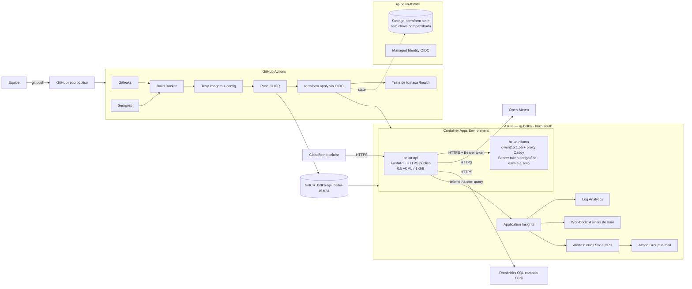

# Secure DevOps Tools & Cloud Computing — Deploy Blindado

Documento base para o PDF da entrega (14 pontos). Cada seção abaixo corresponde a um critério.

## 1. Arquitetura



| Requisito do professor | Onde está |
|---|---|
| Dockerfile enxuto, não root, sem segredo | [`Dockerfile`](../Dockerfile) (multi-stage, `USER 10001`), [`ollama/Dockerfile`](../ollama/Dockerfile), [`.dockerignore`](../.dockerignore) |
| Stack com docker compose | [`docker-compose.yml`](../docker-compose.yml) |
| Nuvem criada por Terraform | [`infra/`](../infra) |
| State e .tfvars fora do repo | backend `azurerm` em Storage Account; `*.tfvars` e `*.tfstate` no [`.gitignore`](../.gitignore) |
| Porta admin nunca aberta a 0.0.0.0/0 | Não há VM, SSH nem RDP: Container Apps é PaaS. Entradas só por HTTPS 443 (TLS gerenciado): a API e o proxy do LLM, que devolve 401 sem token (ver decisão abaixo). Storage do state sem acesso público a blobs e sem chave compartilhada |
| GitHub Actions com build, Gitleaks, Semgrep, Trivy a cada push | [`.github/workflows/devsecops.yml`](../.github/workflows/devsecops.yml) (`on: push`) |
| Segredos em GitHub Secrets | `AZURE_*`, `ALERT_EMAIL`, `DATABRICKS_*` |
| Deploy automático | job `deploy` na `main` → `terraform apply` com a imagem do commit |
| Dashboard 4 sinais de ouro + alerta | Workbook "Belka - Sinais de Ouro" e alertas em [`infra/monitoring.tf`](../infra/monitoring.tf) |

## 2. Pipeline DevSecOps — execução barrada e corrigida

Roteiro para gerar a evidência (fazer numa branch, nunca com segredo real):

1. `git checkout -b demo/segredo-vazado`
2. Criar `app/config_demo.py` com uma credencial **falsa** no formato real, por exemplo:
   `AWS_SECRET = "AKIA` + `IOSFODNN7EXAMPLQ"` (escreva junto, numa linha só, sem o `+`).
3. `git add . && git commit -m "demo: segredo vazado" && git push -u origin demo/segredo-vazado`
4. **Print 1:** job *Gitleaks* vermelho, build/deploy não executados.
5. Corrigir: apagar o arquivo e reescrever o commit (o Gitleaks varre o histórico):
   `git rm app/config_demo.py && git commit --amend -m "demo: corrigido" && git push --force`
6. **Print 2:** pipeline verde.

Alternativa com Trivy: trocar a base para `python:3.8-slim` (fora de suporte) → Trivy barra por CVEs HIGH/CRITICAL → voltar para `python:3.12-slim`.

## 3. Observabilidade — 4 sinais de ouro

Portal Azure → Application Insights `appi-belka` → Workbooks → **Belka - Sinais de Ouro**.

| Sinal | Métrica |
|---|---|
| Latência | `requests.duration` p50 e p95 |
| Tráfego | `requests` por rota a cada 5 min |
| Erros | `success == false` (5xx) e taxa de erro % |
| Saturação | CPU (`UsageNanoCores`) e memória (`WorkingSetBytes`) do Container App |

**Disparar o alerta de verdade** (com `OLLAMA_MIN_REPLICAS=0`, o modo `agent` sem o LLM quente, ou com token Databricks inválido, retorna 503):

```bash
URL=https://<sua-url>
for i in $(seq 1 30); do
  curl -s -o /dev/null -w "%{http_code}\n" -X POST "$URL/api/perguntar" \
    -H "Content-Type: application/json" \
    -d '{"pergunta":"teste de alerta","configuracao":"rag_lora"}'
done
```

O modo `rag_lora` sempre responde 503 em produção (sem torch), então é um gatilho confiável. Em ~5 min: **print** do alerta em *Fired* (Monitor → Alertas) e do e-mail recebido.

## 4. Responsabilidade compartilhada (PaaS — Azure Container Apps)

| Camada | Azure | Equipe |
|---|---|---|
| Datacenter, rede física, hardware | ✔ | |
| Hypervisor, SO do host, Kubernetes gerenciado do Container Apps | ✔ | |
| Certificado TLS e ingress HTTPS | ✔ (emite/renova) | configura (`allow_insecure_connections = false`) |
| Imagem do container (SO base, bibliotecas) | | ✔ Trivy a cada push, base slim, não root |
| Código da aplicação | | ✔ Semgrep, revisão |
| Segredos e credenciais | cofre do Container Apps | ✔ GitHub Secrets, OIDC, Gitleaks |
| Identidade e acesso (IAM) | Entra ID | ✔ menor privilégio: Contributor só no `rg-belka` |
| Dados pessoais e LGPD | criptografia em repouso padrão | ✔ minimização, retenção, transparência |
| Monitoramento | coleta de métricas da plataforma | ✔ dashboards, alertas e resposta |

## 5. LGPD — onde ficam os dados pessoais

| Dado | Pessoal? | Onde fica | Tratamento |
|---|---|---|---|
| Texto da pergunta ao assistente | Pode conter | Somente memória do container durante a requisição | Não é gravado em log nem na telemetria |
| Latitude/longitude (`/api/clima`) | Sim (localização) | Memória; enviado ao Open-Meteo arredondado | Arredondado para 2 casas (~1 km); query string removida da telemetria |
| IP do cidadão | Sim | Application Insights | Mascarado (0.0.0.0) pelo padrão do App Insights |
| Telemetria (rota, duração, status) | Não | Log Analytics `log-belka`, região `brazilsouth` | Retenção de 30 dias; teto de 1 GB/dia |
| Dados de risco (Databricks Ouro) | Não (agregado por município) | Databricks | Somente leitura |
| Assinantes (view LGPD simulada) | Sim | Não consultada pela API em produção | — |

Todos os recursos ficam na região **Brazil South** (se a assinatura de estudante não permitir, documentar a região usada e a transferência internacional).

## 6. Estimativa de custo (mensal, uso de demonstração)

Valores de referência da tabela pay-as-you-go; confirmar na [Calculadora de Preços da Azure](https://azure.microsoft.com/pricing/calculator/) para a região escolhida e anexar o print.

| Recurso | Configuração | Estimativa (US$/mês) |
|---|---|---|
| Container App `belka-api` | 0.5 vCPU / 1 GiB, 1 réplica mínima, majoritariamente ociosa | ~5–10 (parte coberta pela cota gratuita mensal de 180.000 vCPU-s e 360.000 GiB-s) |
| Container App `belka-ollama` | 2 vCPU / 4 GiB, escala a zero, ~1 h/dia de uso | ~5–8 |
| Log Analytics + App Insights | < 5 GB/mês | 0 (5 GB gratuitos) |
| Storage do state | < 1 MB, LRS | < 0,10 |
| Alertas (2 regras de métrica) + e-mail | | ~0,20 |
| GHCR (pacotes públicos) | | 0 |
| **Total (calculadora)** | [estimativa compartilhada](https://azure.com/e/c2f1571ae006489fa4094674da8ad8d8) | **US$ 41,95/mês** (teto: storage dimensionado em 1 TB; com o state real ≈ US$ 8/mês) |

Com `OLLAMA_MIN_REPLICAS=1` 24×7, o LLM sozinho custaria ~US$ 130/mês: manter em 1 só no período de avaliação.

## 7. Checklist de prints para o PDF
- [ ] `docker compose up` rodando e app em `localhost:8000`
- [ ] `docker image inspect belka-api:local --format '{{.Config.User}}'` → `10001`
- [ ] `terraform apply` no log do Actions + recursos no portal
- [ ] Storage do state com o blob `belka.tfstate`
- [ ] Tela de Secrets do GitHub (só nomes)
- [ ] Pipeline barrado (Gitleaks ou Trivy) e pipeline corrigido verde
- [ ] MVP aberto na URL pública (celular)
- [ ] Workbook com os 4 sinais de ouro
- [ ] Alerta *Fired* + e-mail recebido
- [ ] `curl` no `belka-ollama` sem token → 401

## 8. Decisão de arquitetura: LLM atrás de proxy com token

O plano original era deixar o `belka-ollama` com ingress **interno**. A assinatura Azure for Students só recebe ambientes Container Apps **Express**, que não têm descoberta de serviços internos: apps conversam pela URL pública. Tentamos criar um ambiente Standard em todas as regiões permitidas pela política da assinatura (brazilsouth, chilecentral, northcentralus, spaincentral, belgiumcentral), e todas recusaram com `ManagedEnvironmentModeNotSupported`.

Solução, mantendo os dados no Brasil:
- O Ollama (sem autenticação própria) escuta só em `127.0.0.1:11434` dentro do container.
- Um proxy **Caddy** ([`ollama/Caddyfile`](../ollama/Caddyfile)) na porta 8080 exige `Authorization: Bearer <token>` e responde **401** a qualquer outra chamada.
- O token tem 48 caracteres, é gerado pelo Terraform (`random_password`) e vai para os dois apps como *secret*. O container ([`ollama/start.sh`](../ollama/start.sh)) não sobe com token ausente ou curto.
- A comunicação é HTTPS com certificado gerenciado pela Azure.
